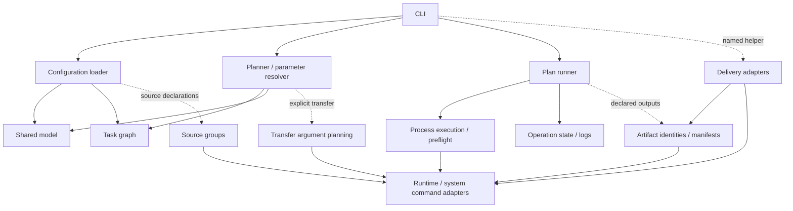

# Devtool source architecture

Devtool is a project-neutral task engine. Application build and rollout policy belongs in the application's own configuration and scripts. The engine exposes a stable command-line/operation-plan interface while keeping its Python implementation modular.

## Repository layout

```text
devtool                         Source-checkout launcher
devtool.toml                    This repository's own engineering tasks
src/devtool_core/
  model.py                      Shared configuration and plan contracts
  cli/                          CLI syntax, command dispatch and internal helpers
  config/                       TOML discovery, schema, options, task parsing
  planning/                     Task dependency graph and parameter resolution
  execution/                    Plan orchestration, subprocesses, logs and state
  runtime/                      System-command environment, SSH/Docker adapters
  artifacts/                    Identities, manifests, archives, fetch and ELF strip
  delivery/                     Transfer plans, rsync, registry, OCI and image bundles
  sources/                      Source group expansion and Git checkout operations
  transport.py, manifest.py     Source-mode helper compatibility entry points
tests/
  unit/                         Fast offline unit and local CLI regression tests
  integration/                  Opt-in real Docker and existing-project checks
examples/
  projects/                     Existing-project compatibility configurations
  simple/, provider/, bridge/   Independent configuration examples
templates/                      Copyable project configuration template
packaging/                      Pinned executable build environment and entry point
scripts/                        Build and distribution smoke-test scripts
docs/                           Public usage, architecture and acceptance evidence
dist/                           Generated wheel/executables (not source-controlled)
```

## Responsibilities and dependencies

| Area | Owns | Does not own |
| --- | --- | --- |
| `model.py` | Configuration/plan data contracts, shared validation primitives | IO, CLI, external processes |
| `config/` | Find TOML; validate identity, parameters, targets, commands, tasks; enable reviewed providers; assemble the task graph | Running commands or preparing releases |
| `planning/` | Topological ordering, per-plan parameter resolution and template rendering, argument vectors, artifact paths, conditional steps | Command execution; SSH connections |
| `execution/` | Preflight, task sequence, process groups, bounded redacted logs, resource locks, recovery and persisted outcomes | Project deployment policy and transfer protocol implementations |
| `runtime/` | Source/frozen helper commands, subprocess environment, SSH and Docker command adapters | Task graph, record lifecycle, archive formats |
| `artifacts/` | File/tree identities, portable directory archives, verified manifests, pinned cache files, ELF stripping | Remote transport, service activation |
| `delivery/` | Translate transfer declarations into helper argv; stage and verify rsync files or registry/OCI/offline images | Activation, application migrations or rollback policy |
| `sources/` | Expand Git source groups into ordinary tasks; validate checkout paths; clone/fetch and initialize missing submodules | Resetting existing user checkouts or running application code |
| `cli/` | Parse arguments, choose a project/task, invoke planning/execution or explicit helper commands, present output | Domain implementation details |

The normal flow is:



Arrows represent implementation dependencies or explicit calls, not automatic deployment steps. The runtime has no dependency on the configuration, planning or execution layers. Directory identity and archive validation no longer import the staging transport. Docker image identity is shared at the runtime boundary instead of being implemented by the registry adapter. OCI archive validation/reconstruction is separate from Docker save/load and SSH transfer. Source declarations are distinct from Git execution.

Local-only projects do not load the remote delivery, Docker, SSH or Git execution modules to produce a plan. Optional features are imported at their explicit boundaries. The architecture regression tests check this in a fresh process and reject upward package dependencies. `[backend]` expands each delegated action into a normal `Task`; the CLI consumes only engine controls and supplies the remaining argv to the existing planner. Delegation does not introduce a second executor or an application-specific adapter inside the engine.

## Extending the engine

- Configuration schema or custom flags: start in `config/` and `cli/arguments.py`; add a configuration and plan regression test.
- Task ordering, conditional execution, or templating: use `planning/`; keep plans read-only and parameter resolution per-plan.
- Command/log/timeout behavior: use `execution/process.py` and `execution/preflight.py`; keep task orchestration in `execution/runner.py`.
- New transport: keep argument planning in `delivery/planning.py`, protocol implementation in `delivery/`, and helper dispatch in `cli/transport.py`. Shared OS/SSH/Docker operations belong in `runtime/`; reuse artifact validation rather than importing a different transport for utility functions.
- Source or artifact preparation: use `sources/` or `artifacts/` respectively. Keep these usable without importing application operations.

The public CLI, schema-1 TOML, serialized plans/history and helper command names are compatible with earlier releases. `python -m devtool_core.transport`, `python -m devtool_core.manifest`, `python -m devtool_core.sources` and the packaged executable's `_internal` helper names remain valid for old source-mode and remote plans. The internal Python implementation modules are not a supported application API; their import paths were reorganized in 0.11.0. Project providers should use the documented configuration-fragment contract rather than importing implementation modules.

## Regression checks

From the repository root:

```sh
./devtool test               # unit, CLI, architecture, Git/ELF fixtures
./devtool test docker        # opt-in isolated real Docker save/load and OCI test
./devtool build binary      # native architecture executable
./devtool test binary       # run executable in a Python-free container
./devtool build wheel
```

Use the [three-project compatibility matrix](validation.md) for packaged-binary integration with existing application checkouts. It is read-only and does not deploy or replace their launchers.
